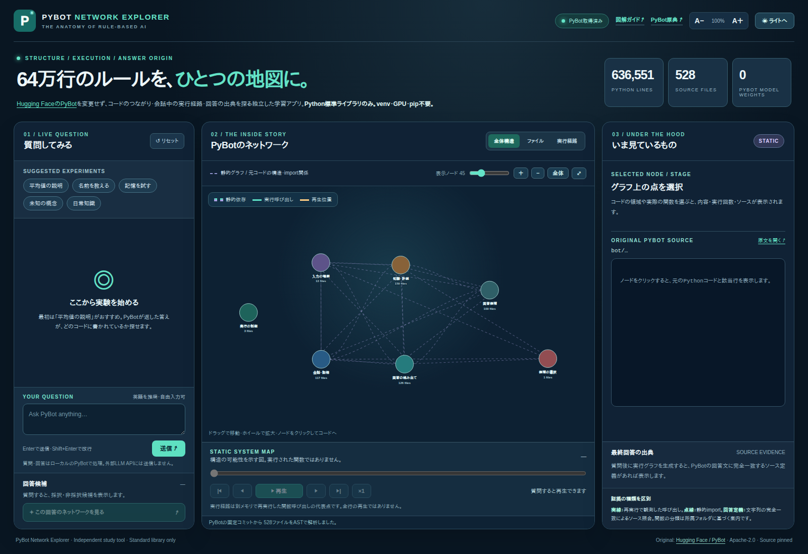
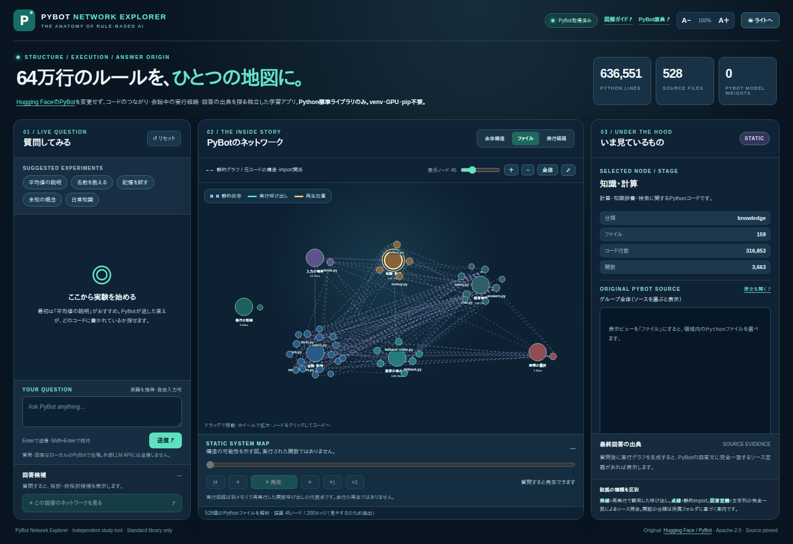
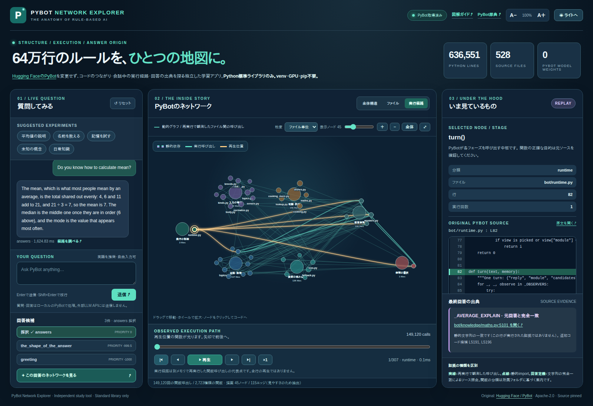
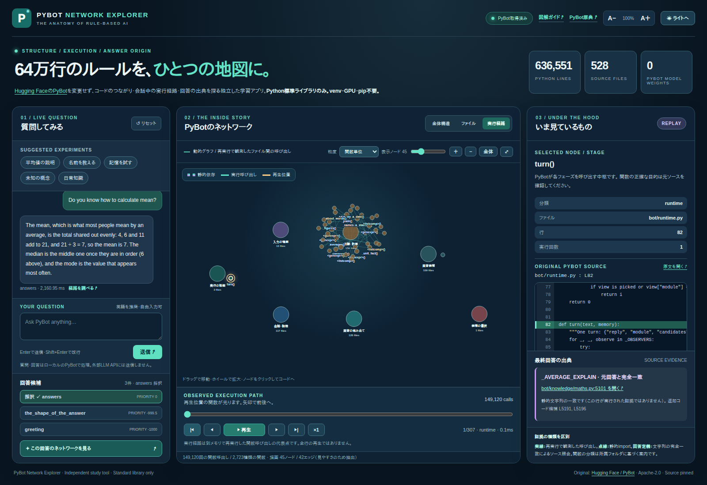
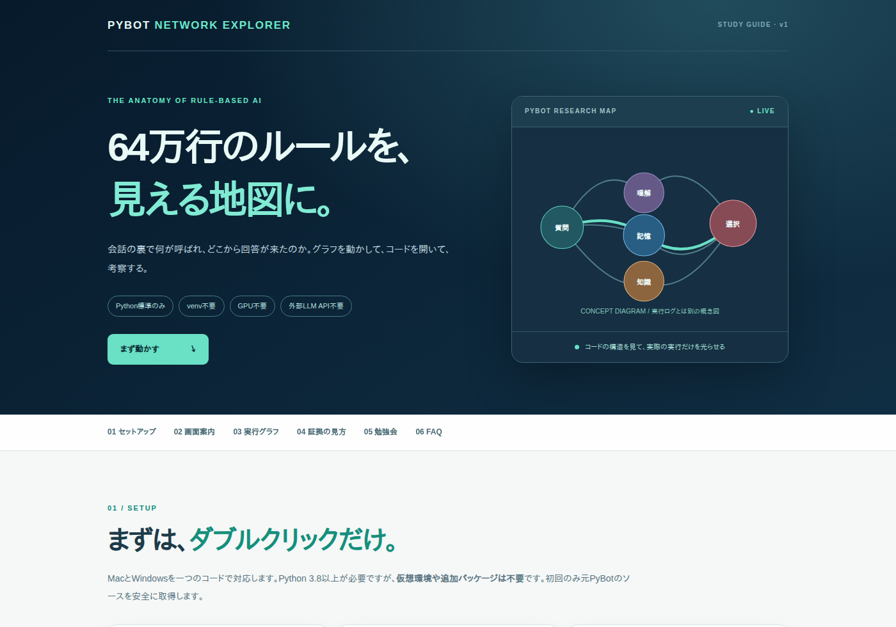

# PyBot Network Explorer

**64万行のルールを、ひとつの地図に。**

Hugging Faceの [PyBot](https://github.com/huggingface/pybot) をそのまま実行し、**全体構造・実際に通った関数・回答の出典**を、動くネットワークで学ぶアプリです。

▲ 実際のPyBotを動かして撮影した画面。ノードをクリックすると元コードへジャンプできます。

[**🚀 ワンクリックで起動**](#-macwindowsでワンクリック起動) · [**📖 HTML図解ガイド**](docs/MANUAL.html) · [**🧠 3つのビュー**](#-3つの見方を切り替える)

## 🔬 何ができる？

<table><tr>
<td width="50%" valign="top">
<b>1. 全体の構造を見渡す</b> 

runtime、memory、knowledge、composeなどの領域をグラフで観察。点線は静的な依存関係です。
</td>
<td width="50%" valign="top">
<b>2. 実行された関数のネットワークを再生する</b> 

質問ごとに観測した関数がつながります。時刻バーで進めたり戻したりしながら、コードを開けます。
</td>
</tr></table>

<strong>さらに細かい「関数単位」の実行ネットワークを見る</strong>

動的実行グラフの「粒度」で<strong>ファイル単位 ↔ 関数単位</strong>を切り替えられます。最初はまとまりを俯瞰し、興味がある場所だけコードへ進む設計です。

**3. 最終回答がどこから来たかを探す**

たとえば「Do you know how to calculate mean?」の説明文は、PyBot純正の <a href="https://github.com/huggingface/pybot/blob/7d63c7fbebb44c7e466e5c8b5c1f341ab767929e/bot/knowledge/maths.py#L5101-L5104">bot/knowledge/maths.py の5101行</a> に、定数 <code>_AVERAGE_EXPLAIN</code> として書かれています。

> **観測と解釈は分ける：** 実線は別メモリで再実行して観測した関数呼び出し。点線は静的コード依存。回答文字列の出典は静的な完全一致検索です。関数が呼ばれたことと、回答に因果的に貢献したことは同義ではありません。

## 🧠 3つの見方を切り替える

| ビュー | 何がわかる？ | 根拠 |
| --- | --- | --- |
| **全体構造** | どんな領域が存在し、どう関係するか | Python ASTによる静的解析 |
| **ファイル** | Pythonファイルの分布と所属 | AST + フォルダ構造 |
| **実行経路** | その質問で、実際にどの関数が呼ばれたか | sys.setprofileによる再実行時の計測 |

これはGNNモデルを学習するアプリではなく、実際のプログラムの<strong>依存グラフと呼び出しグラフを可視化するアプリ</strong>です。

グラフは拡大・縮小・ドラッグ移動・ノード選択に対応。再生・停止・コマ送り・速度変更・時刻バーも使えます。数万〜十数万回の呼び出しは見やすく集約し、総数と抽出数を区別しています。

## 🚀 Mac／Windowsでワンクリック起動

**Python 3.8以上だけ。GPU・Conda・venv・pipインストール・LLM APIキーは不要です。**

1. このページの **Code → Download ZIP** から取得して展開する（git cloneも可）。
2. Macなら **start_mac.command**、Windowsなら **start_windows.bat** をダブルクリックする。
3. ブラウザで「平均値の説明」を選び、**送信 → この回答のネットワークを見る**。

ターミナルの場合：Macは <code>python3 launch.py</code>、Windowsは <code>py -3 launch.py</code>。

初回だけ公開PyBotの固定コミットをHTTPSで取得し、.runtime/pybot に保存します。2回目以降は保存済みのコードを使用します。証明書検証を無効化しません。macOSのPython.org版でSSLエラーが出た場合にはOS標準curlによる安全な再試行を用意しています。

## 📖 スクショ入りHTMLマニュアル

 スタイルと実スクリーンショットを埋め込んだ単体HTML。オフラインでも読めます。

[**図解ガイドを開く**](docs/MANUAL.html)

## このアプリは誰が作ったPyBotなの？

PyBotはHugging Faceが2026年11月に公開した実験です。AIエージェント群が大量のPythonルールを生成し、実行時には学習済みLLMの重みを使わず会話します。

**Network ExplorerはPyBotの作者・公式アプリではありません。** 原典を「知る・試す・解析する」ための独立した勉強会用ツールです。

| PyBot純正（Apache-2.0） | このNetwork Explorerが追加 |
| --- | --- |
| 会話、候補、採択、メモリ、回答文 | グラフ表示・静的AST解析・関数呼び出し再生・ソース探索 |
| ルール実行、学習済みモデル重みなし | 標準ライブラリ + ブラウザ標準SVG |
| [Hugging Face / PyBot](https://github.com/huggingface/pybot) | 独立した学習・研究用インターフェイス |

## 開発と検証

Mac・Windows・Linuxの自動テスト、PyBot実ソースを使った統合テスト、実ブラウザの画面テストをGitHub Actionsで実施します。

検証コマンドは <code>python -m unittest discover -s tests -v</code> と <code>python launch.py --self-check</code> です。

主なコード：<code>network/graph.py</code>（ASTと実行グラフ）、<code>network/engine.py</code>（会話・再実行）、<code>network/server.py</code>（ローカルHTTP）、<code>web/</code>（依存なしSVG UI）、<code>docs/</code>（図解操作ガイド）。

---

<b>質問する → 地図を光らせる → コードを辿る → 原典に戻る。</b>

